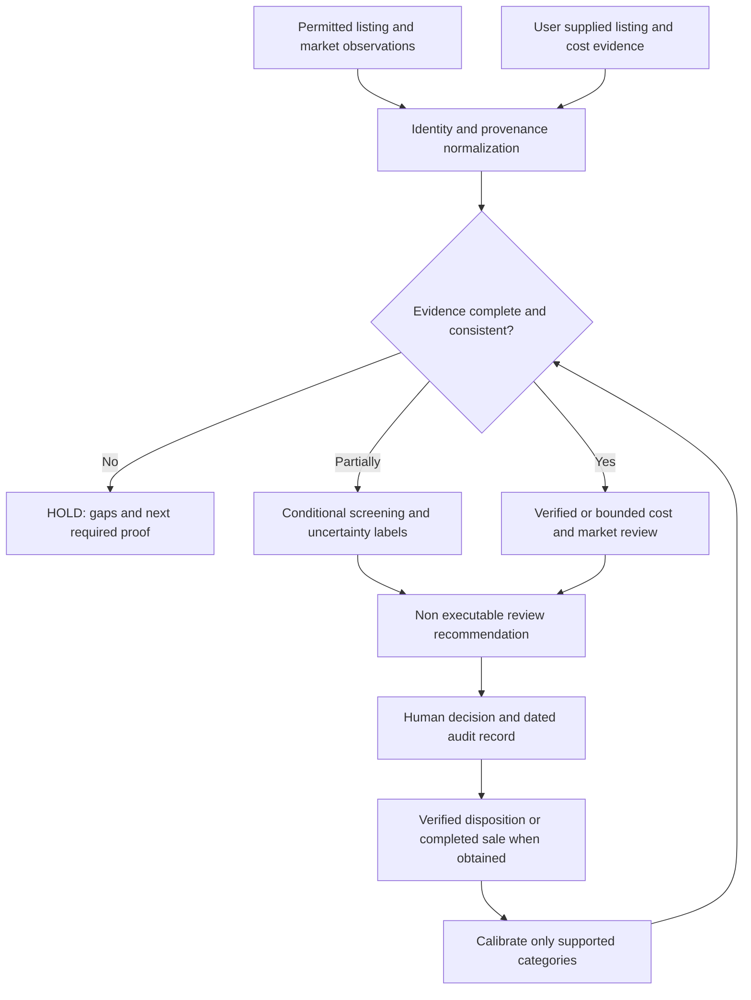

# Technical architecture | Public abstraction

**v2.1.0 | October 14, 2026 | Nathaniel Schroeder**

This is a non-confidential conceptual architecture. It describes the product's functional boundaries and review lifecycle, **not a source-code blueprint**.

## System concept

## Major components and state

| Concern | Architecture-level description | Evidence status |
| --- | --- | --- |
| Public user experience | Responsive information, guided intake, research-oriented pages and documented sample flows | Published working prototype |
| Restricted workspace | Private review, saved observations, owner Watchlist and controlled exports | Server-side boundaries implemented; real owner acceptance remains incomplete |
| Source/provenance | Capture observation type, date, identity, conflicts and supporting evidence | Existing research controls; continuous permissioned sync is not verified live |
| Calculation and review | Separate assumptions from supported costs and resale; fail closed on material gaps | Prototype logic plus tested non-executable reference engine |
| Durable state | Node HTTP application and storage abstraction backed by PostgreSQL | Published database mode recorded; source-level restore rehearsal passed in disposable PostgreSQL |
| Authentication | Protected owner access with durable server-side sessions and restricted routes | Source and anonymous-denial tests; deployment-specific owner workflows need acceptance |
| Reference autonomy | Frozen case input, scoped policy, shadow-only decision, auditable intent | Tested in source; no live transaction capability or release |
| Outcome learning | Maintain a connection between a decision snapshot and a completed disposition | Designed and partially researched; insufficient actual full-economics outcome matches |

## Trust boundaries

**Public visitors must not receive private data.** Content such as marketing pages and synthetic examples are distinct from authenticated owner APIs and stored records. A hidden navigation element is not access control.

**A model suggestion must not become a verified identity, cost or compatible part.** Verification requires evidence from a suitably authoritative source or appropriately qualified reviewer.

**The calculation layer must not silently approve transactions.** The reference engine can classify a decision for analysis while still returning a non-executable disposition. Approval to spend money requires distinct human, legal, financial, source and execution controls.

**A file export is not a raw PostgreSQL recovery backup.** The private project contains a disposable restore test and a raw-state attestor that has not been executed on the live owner database.

## Technical stack at a safe disclosure level

The working application is a web-based product using a Node runtime, browser interfaces, server-side routes and PostgreSQL-backed persistence. Repository-controlled tests cover route protection, storage, user journeys and synthetic decision scenarios. The recorded production publication path is Replit. This public repository is a stand-alone GitHub documentation and demo surface.

I am deliberately **not** publishing infrastructure endpoints, table definitions, auth implementation, private API contracts, database credentials, algorithm weights, policy thresholds, integration account settings or deal records.

## Areas I want reviewed

- How to make permitted-source observation ingestion robust and maintainable.
- How to preserve identity and condition certainty across revisions and source conflicts.
- How to prevent historical price leakage and look-ahead bias in replay.
- How to link observed listings to actual completed-sale outcomes at scale.
- How to roll out shadow-only decisions with audited human overrides before live execution.
- Whether the architecture should become a maintained workflow integrated with existing dealer software rather than a full replacement.

## Agricultural auction data boundary

Source discovery, exact auction event/lot matching, asset configuration, fee and cost translation, public price-realized labeling and verified paid transaction outcomes need separate types and dated provenance. A completed bid is not a realized reseller profit, and a matching title is not a matching machine.

A permitted scheduled observer should preserve the decision-time snapshot rather than rewrite history. The existing private Watchlist and tested reference logic are a foundation, not proof of a production auction connector.

[Full data automation research](AUCTION_DATA_AUTOMATION.md).

© 2026 Nathaniel Schroeder. All rights reserved.
